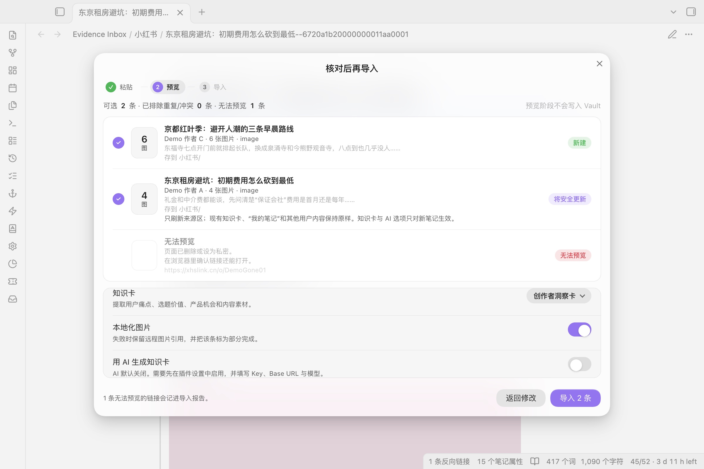
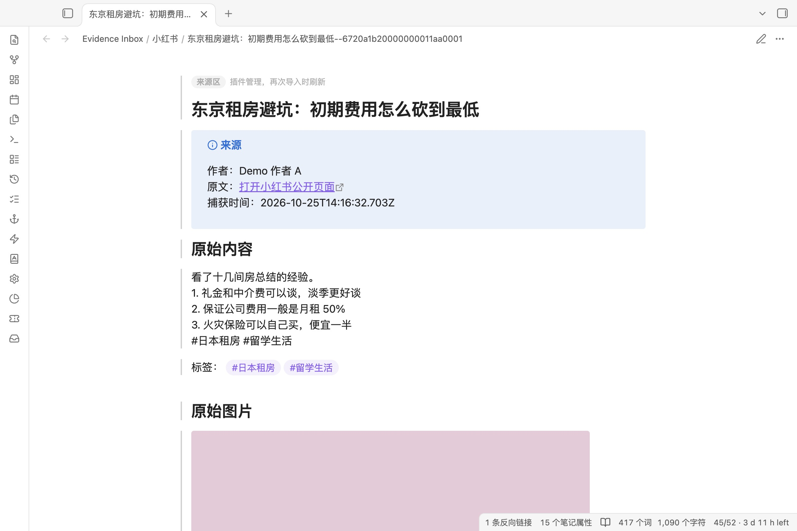
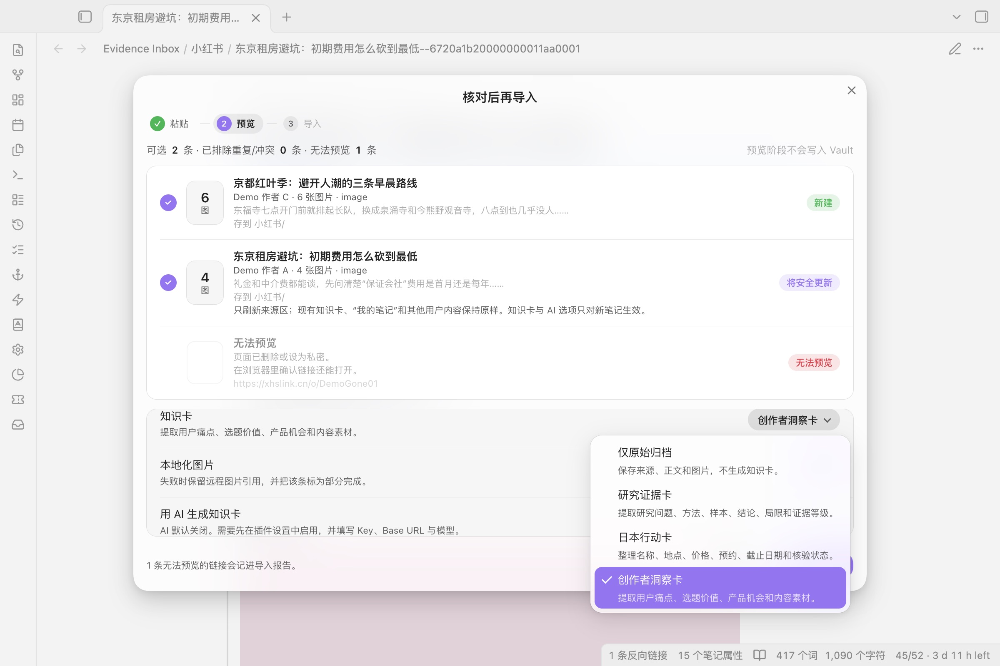
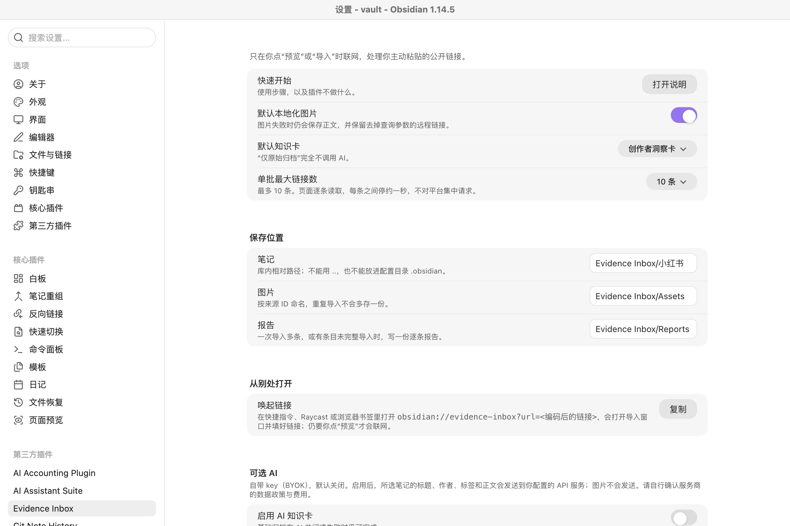

<div align="center">

# Evidence Inbox

**Turn a saved Xiaohongshu post into a note you can check later: the original text, the images, the source link, and a card for what you take from it.**

把“收藏了一条小红书”变成可核验、可连接、可行动的知识入口。

[Features](#features) · [Install](#install) · [Network use](#network-use) · [Privacy and safety](#privacy-and-safety) · [How it works](#how-it-works) · [中文说明](#中文说明) · [日本語](#日本語)

<picture>
  <source media="(prefers-color-scheme: dark)" srcset="docs/screenshots/preview-dark.jpg">
  
</picture>

</div>

## Why

Bookmarks inside an app are easy to collect and hard to use: the post may disappear, the link carries tracking parameters, and nothing separates what the author said from what you concluded. Evidence Inbox saves a public post into your vault with its source, keeps the author's content apart from your own notes, and lets you add a structured card for the part you want to act on.

## Features

- **Paste 1–10 share texts or links**: `xhslink` and `xhs.cn` short links, `xiaohongshu.com` or `rednote.com` note pages (`/explore/…`, `/discovery/item/…`, and notes opened from a profile or search page). Nothing is written until you have previewed them.
- **Clipboard offer.** When the import window opens and the clipboard holds supported links, a chip offers to add them. It never fills anything on its own.
- **Open from elsewhere.** `obsidian://evidence-inbox?url=<encoded link>` opens the import window with the link filled in, for Shortcuts, Raycast or a browser bookmarklet. Nothing is fetched until you press Preview.
- **Preview** title, author, excerpt, number of images, whether you already have it, and where it will be saved.
- **Save** each post as Markdown with YAML properties and, optionally, local copies of its images.
- **Knowledge cards:** raw archive only, research evidence (question, method, sample, conclusion, limits, evidence level), a Japan action card (Japanese name, place, price, booking, deadline, checked or not), or a creator insight card.
- **No duplicates.** The same post imported three times stays one note; only the plugin-managed part is refreshed, and your card and notes are never touched.
- **Honest failures.** Each link gets its own result (created, updated, partial, skipped, failed); one failure does not stop the batch, and a report is written for larger imports.
- **Optional AI** with your own key and endpoint, off by default. Without it, everything except the AI draft still works.

**Looks at home on a Mac.** The import window is a translucent glass sheet over your note; lists and settings are solid grouped rows, like System Settings. It follows your theme, light or dark, and your accent colour. With *Reduce transparency* or *Increase contrast* turned on in macOS, the glass becomes solid; with *Reduce motion*, nothing animates.





<picture>
  <source media="(prefers-color-scheme: dark)" srcset="docs/screenshots/settings-dark.jpg">
  
</picture>

## Install

1. Download `main.js`, `manifest.json` and `styles.css` (or the zip) from the latest release.
2. Put them into `<your vault>/.obsidian/plugins/evidence-inbox/`.
3. **Settings → Community plugins**, reload, enable **Evidence Inbox**. Requires Obsidian desktop 1.11.4 or later.
4. Click the inbox icon in the ribbon, or run **导入小红书公开链接**.

## Network use

Evidence Inbox only goes online when you press **Preview** or **Import**, and only to these places:

| Service | Why |
| --- | --- |
| `xiaohongshu.com`, `rednote.com`, `xhslink.com`, `xhslink.cn`, `xhs.cn` | Read the public page of each link you pasted, and follow its short-link redirect. Pages are read one at a time, about a second apart. |
| `*.xhscdn.com` | Download the post's images, only if you keep **Save images locally** on. |
| The AI endpoint you configure | Only if you turn AI on and pick an AI card. Off by default; no endpoint is contacted until you set one. |

There is no telemetry, no account, no payment and no background sync. Nothing is read from outside your vault.

## Privacy and safety

- **No login.** It never scans a QR code, reads your account, favourites, followers or albums, and never stores cookies, `xsec_token` or page signatures.
- **No background activity.** It only fetches when you press import.
- **Only Xiaohongshu, only HTTPS.** Every redirect is checked again for the host and path; addresses are resolved first and private or reserved IPs are refused; the connection is pinned to the checked address so DNS cannot be switched in between.
- **Size and type limits** on pages and images (MIME type, file signature, 15 MB).
- **AI** receives only the selected note's title, author, tags, text and your goal, never images or other notes. The key is kept in Obsidian's SecretStorage, not in `data.json`.

Only archive content you are entitled to keep, and keep the source link.

**Platform terms.** This is an unofficial tool, not affiliated with Xiaohongshu. Xiaohongshu's user agreement restricts copying and automated collection of platform content without its permission. Evidence Inbox is built for a person keeping their own reading notes: it handles only links you paste yourself, at most ten at a time, never logs in and never works around access limits. Whether a given use is allowed is up to you and the platform's terms; do not use it to collect content in bulk or for commercial reuse.

## How it works

- Page data comes from the public page's embedded state, parsed as data (page scripts are never run); if that is missing, Open Graph tags are used and the note is marked `partial`.
- Each note carries a stable 24-character source ID, used for file names and duplicate detection.
- The note body has three regions: plugin-managed source text, a knowledge card that becomes yours once created, and **My notes**, which is always yours.

See [docs/ARCHITECTURE.md](docs/ARCHITECTURE.md) and [docs/PRD.md](docs/PRD.md).

`styles.css` is generated. Edit `styles/plugin.css` (or the shared `styles/apple-kit.css`, the same in all of my plugins) and run `pnpm run styles`.

## Changelog

**0.3.0**

- More links accepted: `rednote.com` note pages, `xhs.cn` short links, and notes opened from a profile or search page (rewritten to the `/explore/<id>` form).
- Clipboard offer in the import window, and an `obsidian://evidence-inbox?url=` link to open it from Shortcuts, Raycast or a bookmarklet.
- Public pages are now read one at a time, about a second apart, instead of three at once.
- Settings regrouped under native headings (Saved to, Appearance, Open from elsewhere, Optional AI); folder checks also refuse a custom config folder.
- README lists every remote service the plugin contacts, and the platform-terms note.
- Code passes the official `eslint-plugin-obsidianmd` checks with no errors.
- New look in the current Apple glass style: the import window is a glass sheet, lists and settings are grouped rows, round checks, capsule buttons and segmented controls. Follows your theme and accent colour, and turns solid with Reduce transparency or Increase contrast.
- The optional paper & ink style from 0.2.0 is removed; the windows always follow your theme.

**0.2.0**

- Import window redesigned: three steps (paste, preview, import), one row per link with its status, and the reason when a link is left out. The card type is a one-click choice.
- Generated notes show in reading view which part the plugin refreshes, which part is yours once created, and which part it never touches.
- Optional **纸墨风格 (Paper & ink style)** in settings. Off by default, so the windows follow your theme.
- Styles rewritten from scratch on a small shared style kit.

**0.1.0** — First public alpha.

## Status

`0.3.0 beta`. 59 automated tests and the official Obsidian ESLint rules pass, using synthetic page fixtures. The 30-sample check on real public posts described in [docs/TEST_SAMPLES.md](docs/TEST_SAMPLES.md) has not been run yet, so real-world success rates are not claimed. Mobile is untested.

## License

MIT

---

## 中文说明

## 现在能做什么

- 接受分享文本、`xhslink.cn` / `xhslink.com` / `xhs.cn` 短链接，`xiaohongshu.com` 与 `rednote.com` 的 `/explore/<id>`、`/discovery/item/<id>` 公开笔记链接，以及从主页、搜索页点开的笔记链接（自动改写为 `/explore/<id>`）；
- 打开导入窗口时，如果剪贴板里有受支持的链接，会出现“填入”提示，不会自动填；
- `obsidian://evidence-inbox?url=<编码后的链接>` 可从快捷指令、Raycast、浏览器书签唤起导入窗口并填好链接，仍需点“预览”才联网；
- 页面逐条读取，每条之间停约一秒；
- 界面是苹果的玻璃风格：导入窗口是半透明玻璃，列表和设置是分组行；跟随主题和强调色，系统开了“降低透明度”“增强对比度”时自动变实底；
- 一次预览和导入 1–10 条，预览阶段不写 Vault；
- 显示标题、作者、正文摘要、图片数量、重复状态和目标路径；
- 保存 Markdown + YAML，并可把公开图片本地化；
- 以 `evidence_source_id` 去重，同一来源重复导入只刷新插件来源管理区；
- 永远保留可手填知识卡、`## 我的笔记` 和管理区之外的用户内容；
- 一条失败不影响同批其他链接，并生成逐条报告；
- 提供“仅原始归档”、研究证据卡、日本行动卡、创作者洞察卡；
- 可选 BYOK AI；AI 关闭、未配置或失败时，基础归档仍能完成。

## 明确不做什么

- 不扫码或网页登录小红书；
- 不读取账号收藏、点赞、关注、主页或专辑列表；
- 不保存或输出 Cookie、`xsec_token`、验证码、页面签名；分享参数只用于当次公开页面请求；
- 不绕过访问限制、风控或反自动化机制；
- 不后台轮询或定时同步；
- v0.1 不下载视频，不做图片 OCR 或视频转写。

请只归档你主动提交、公开可见且有权保存的内容，并保留原始来源链接。

**平台条款：** 本插件是非官方工具，与小红书无关联。《小红书用户服务协议》（2026-03-23 版）限制未经许可复制、读取平台内容和以抓取等方式获取内容。插件只为个人整理阅读笔记而设计：只处理你亲手粘贴的链接、每批最多 10 条、不登录、不绕过任何访问限制。具体用途是否被允许由你自己对照平台条款判断；请勿用于批量采集或商业再利用。

## 安装

需要 Obsidian 桌面版 `1.11.4+`（使用 SecretStorage 和桌面端网络读取）。从最新 release 下载 zip，解压到 `<你的库>/.obsidian/plugins/evidence-inbox/`（里面应有 `main.js`、`manifest.json`、`styles.css`），在“设置 → 第三方插件”里刷新并启用。

从源码构建需要 Node.js 20+ 与 pnpm：

```bash
pnpm install
pnpm run check   # 类型检查、测试、生产构建
```

## 第一次导入

1. 从小红书复制一条公开笔记的分享文本；
2. 打开 Evidence Inbox，粘贴分享文本并点“预览”；
3. 核对标题、作者、图片数量和保存路径；
4. 选择知识卡：
   - `仅原始归档`：完全不调用 AI；
   - `研究证据卡`：研究问题、方法、样本、结论、局限、证据等级；
   - `日本行动卡`：日文名称、地点、价格、预约、截止日期、核验状态；
   - `创作者洞察卡`：用户痛点、选题价值、产品功能、内容素材；
5. 确认是否本地化图片；
6. 点“导入已选”；完成后可逐条打开笔记或报告。

主页、专辑、私密/已删除笔记不是 v0.1 的支持对象。插件会如实报告失败，不会把“页面读取失败”伪装成成功的零条结果。

## 输出结构

默认目录：

```text
Evidence Inbox/
├── 小红书/        # Markdown 来源笔记
├── Assets/        # 本地化图片
└── Reports/       # 多条或异常导入报告
```

每篇来源笔记含有：

```yaml
evidence_inbox_version: "1"
platform: "xiaohongshu"
evidence_source_id: "公开笔记 ID"
source_url: "无查询参数的公开来源链接"
source_tags: ["来源原始标签"]
extraction_method: "initial_state | open_graph"
capture_status: "complete | partial"
media_status: "complete | partial | skipped"
ai_status: "complete | failed | disabled | not_requested"
knowledge_template: "raw | research | japan | creator"
```

正文分成三个边界：

```text
<!-- evidence-inbox:managed:start -->
插件可安全刷新的来源正文与图片
<!-- evidence-inbox:managed:end -->

<!-- evidence-inbox:knowledge:user-owned:start -->
可手填的知识卡；创建后由用户拥有
<!-- evidence-inbox:knowledge:user-owned:end -->

<!-- evidence-inbox:user:start -->
## 我的笔记
这里永远由用户拥有
<!-- evidence-inbox:user:end -->
```

如果发现同源旧笔记却没有管理标记，预览会标为冲突并默认排除；插件不会下载图片、调用 AI 或修改文件。重复导入受管笔记时，知识卡与用户笔记保持原样，知识卡/AI 选项只对新建笔记生效。

## 可选 AI 与隐私

AI 默认关闭，也不预设模型。只有同时满足以下条件，导入弹窗才允许启用 AI：

- 设置中主动启用；
- 填写 API Key；
- 填写 HTTPS Base URL（本机 `localhost` 允许 HTTP）；
- 填写该服务实际支持的模型 ID。

启用后只发送所选笔记的标题、作者、标签、正文和你填写的“当前目标”；不会发送图片、Cookie、分享参数或 Vault 其他笔记。API Key 使用 Obsidian `SecretStorage` 保存，不写入插件 `data.json`；设置页提供立即清除按钮。插件因此要求 Obsidian `1.11.4+`。

AI 输出始终标为“待核验”。它不是事实核验，也不会把平台内容自动伪装成你的个人结论。

## 失败语义

| 结果 | 含义 |
| --- | --- |
| `created` | 新建来源笔记，所选必需步骤完成 |
| `updated` | 安全刷新已有笔记的管理区 |
| `partial` | 正文已保存，但图片或 AI 等可选步骤失败 |
| `skipped` | 为保护现有用户内容而没有写入 |
| `failed` | 该条没有形成可用来源笔记；同批其他条目继续 |

图片失败会保留去掉查询参数的公开远程引用，下一次导入同一来源时会重新尝试本地化。AI 失败会留下受保护的可手填模板。

预览和导入进度页都可取消。取消或停用插件会中止页面/媒体请求并阻止后续条目开始；对 Obsidian 原生接口无法撤销的在途 AI 请求会立即停止等待并忽略结果。已经完成写入的条目不会回滚。

## 开发验证

```bash
pnpm run typecheck
pnpm run lint    # 官方 eslint-plugin-obsidianmd
pnpm test
pnpm run build
```

自动化测试覆盖：

- URL/路径白名单、重定向逐跳校验、公开 IP 检查、批内去重与最大 10 条；
- `window.__INITIAL_STATE__` 安全解析，不执行页面脚本；
- 一致的 24 位公开来源 ID；Open Graph 回退明确标记为 `partial`；
- 文件名始终保留来源 ID，长标题不碰撞；
- 媒体域名、HTTPS、MIME、文件魔数和 15 MB 限制；
- AI/网络错误脱敏；
- 同一来源连续导入三次仍只有一份；
- 重复更新只替换来源管理区，手填知识卡、用户标签和用户笔记保留；
- 单条失败不阻塞同批其他条目；
- 图片或 AI 失败时基础归档降级完成。

真实样本验收方法见 [docs/TEST_SAMPLES.md](docs/TEST_SAMPLES.md)，产品范围见 [docs/PRD.md](docs/PRD.md)，模块讲解见 [docs/ARCHITECTURE.md](docs/ARCHITECTURE.md)。

## 已知限制

- 小红书公开页面结构可能变化；解析失败时需要更新兼容层；
- 公开页面与媒体只允许 HTTPS；每一跳重定向都会重新检查域名、路径与公开 IP，并固定已验证的 DNS 地址；
- 页面与图片采用流式大小限制；AI API 响应仍由 Obsidian 网络接口读取；
- 本地单元测试不能证明 90% 真实页面成功率；必须完成 30 条合法样本验收；
- Obsidian 移动端未验证，`manifest.json` 暂时标记为桌面插件。

## 卸载

1. 在 Obsidian `1.11.4+` 中禁用 Evidence Inbox；
2. 如使用过 AI，在设置中先点“清除 API Key”；
3. 删除 `.obsidian/plugins/evidence-inbox/`；
4. `Evidence Inbox/` 下的 Markdown、图片和报告不会自动删除，由你自行保留或整理。

## 日本語

小紅書（RED）の公開投稿のリンクを貼ると、本文・画像・出典を Obsidian のノートとして保存するプラグインです。ログインはせず、アカウントの保存一覧も読みません。

- 1〜10 件をまとめて貼り、保存前にプレビューで確認します。
- 同じ投稿を何度取り込んでも 1 つのノートのままで、自分で書いたカードやメモは上書きしません。
- 研究の根拠カード、日本での行動カード（名前・場所・料金・予約・締切・確認済みか）などのテンプレートつき。
- 通信は、貼ったリンクの小紅書ページ（1 件ずつ、約 1 秒おき）、画像、任意で設定した AI だけです。小紅書の HTTPS だけに限り、リダイレクトのたびに宛先を確認し、内部ネットワークへの接続を拒否します。
- AI は任意で、初期設定ではオフです。
- 小紅書とは無関係の非公式ツールです。小紅書の利用規約はコンテンツの無断複製や自動収集を制限しています。自分で貼ったリンクを個人のメモとして残す用途に限り、大量収集や商用には使わないでください。
