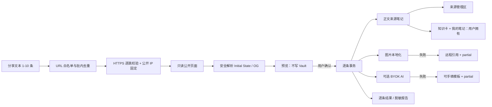

# 架构与学习地图

## 一张图理解输入、输出和失败路径

## 模块责任

| 模块 | 输入 | 输出 | 失败策略 |
| --- | --- | --- | --- |
| `core/urls.ts` | 任意分享文本 | 最多 10 条允许 URL | 拒绝 lookalike host；不写库 |
| `network/safe-get.ts` | 允许的页面/媒体 URL | 逐跳校验的流式响应 | HTTPS、域名/路径、公开 IP、DNS 固定、体积上限 |
| `network/xhs-client.ts` | 允许 URL | 公开 HTML | HTTP/体积/重定向异常直接失败 |
| `core/xhs-parser.ts` | HTML 字符串 | `EvidenceSource` | 不执行 JS；无公开笔记 ID 则失败 |
| `ui/import-modal.ts` | 来源预览 | 用户选择 | 预览阶段零写入 |
| `network/media-downloader.ts` | 公开图片 URL | 稳定本地路径 | 失败保留远程引用 |
| `network/ai-client.ts` | 当前来源文本 | 结构化知识卡 | 失败回退可手填卡片 |
| `vault/vault-writer.ts` | 来源 + 状态 + 卡片 | 新建/安全更新笔记 | 无标记旧笔记跳过 |
| `import/import-service.ts` | 已确认预览 | 每条结果 + 报告 | 捕获单条错误，继续下一条 |

## 为什么不用旧账号同步项目

旧实验的输入边界是账号会话、收藏、点赞与专辑，需要 Cookie、页面签名与账号级状态；本产品的输入边界是用户主动提交的公开链接。两者的风险、测试、用户承诺和发布许可不同，因此新项目独立实现，不把旧登录代码隐藏在发布包里。

## 三个最重要的设计决定

### 1. 先预览，再写入

网络读取与 Vault 写入是两个阶段。用户能在产生文件前看到：解析是否成功、它是不是重复来源、将写到哪里、会不会调用 AI。

### 2. 来源状态与 AI 状态分开

`capture_status`、`media_status`、`ai_status` 三轴独立。这样 AI 超时只意味着知识卡未完成，不会把已经拿到的原始正文丢掉。

### 3. 来源管理区与用户拥有区分离

插件只替换两个 HTML 标记之间的来源受管块。知识卡创建后属于用户，和“我的笔记”、管理区外文本一起原样保留。没有标记的同源文件在预览中标为冲突，并在图片或 AI 请求前跳过。

## 你应该能讲清楚的五个问题

1. **输入是什么？** 用户主动粘贴的公开链接，不是账号和 Cookie。
2. **唯一键是什么？** 公开笔记 ID，也就是 `evidence_source_id`。
3. **失败会怎样？** 每条单独失败；正文、图片、AI 三层分别降级。
4. **为什么不会覆盖我的内容？** 只替换来源受管标记区；知识卡和“我的笔记”由用户拥有，无标记冲突则跳过。
5. **为什么它不是普通导入器？** 原始来源保留，同时把待核验、相关性、连接和 30 分钟动作变成显式结构。

## 下一阶段

完成 30 条合法样本后，按失败分布决定第一个兼容性补丁。不要在真实成功率未知时提前加入登录、OCR、视频、移动端或付费授权。
